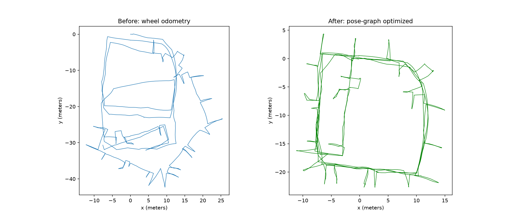
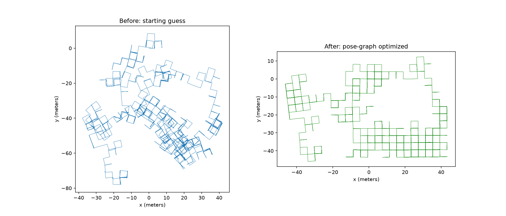
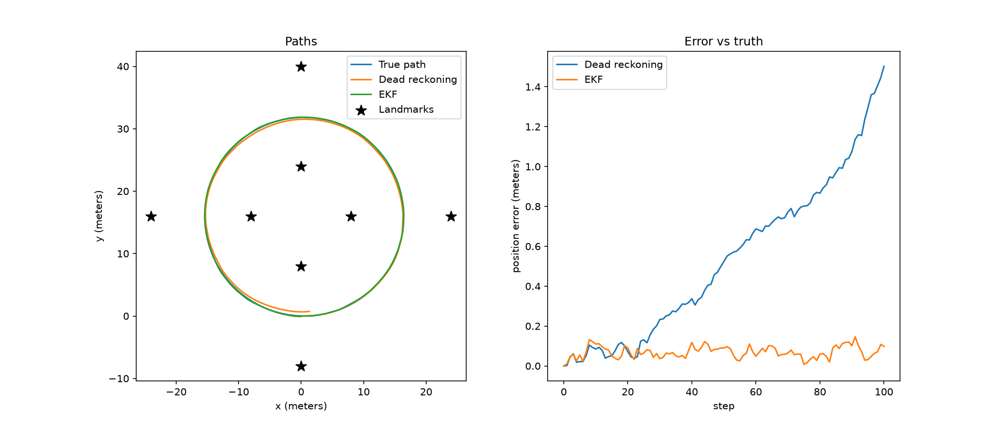
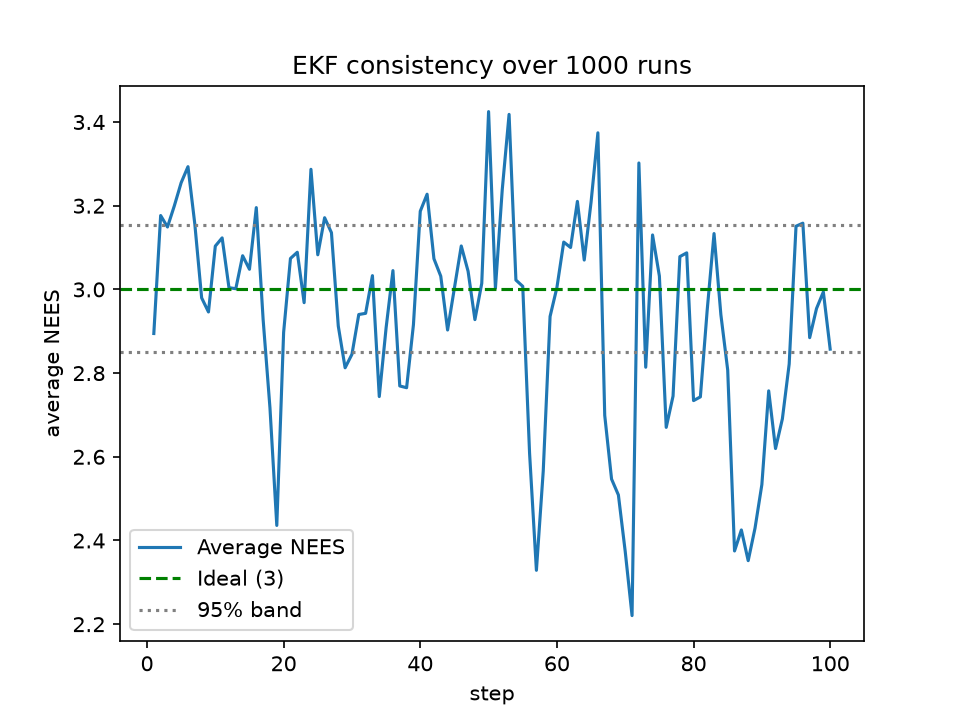

# slamkit

A C++17 library for robot state estimation: a simulator, Extended
Kalman Filter (EKF) localization with statistical consistency testing, and 2D
pose-graph SLAM with sparse Gauss-Newton and Levenberg-Marquardt optimizers.
The optimizers read standard g2o files and run on the Intel and M3500 benchmark
datasets.

| Intel Research Lab | M3500 |
|---|---|
|  |  |

*Left of each pair: the starting guess. Right: after optimization.*

## Why this exists

A robot can't measure its position directly. Wheel odometry drifts, and
landmark sensors are noisy. State estimation combines them into a best guess.
This project builds that in three layers, each graded against ground truth or a
reference library:

1. A **simulator** with known ground truth.
2. An **EKF** that fuses odometry and landmarks, tested for statistical honesty.
3. **Pose-graph SLAM**, which fixes the whole trajectory at once when the robot
   revisits a place.

## What's implemented

- **SE(2) poses**: compose, inverse, relative pose, angle wrapping.
- **Simulator**: a robot driving a loop with noisy wheel odometry and a noisy
  range-and-bearing sensor (10 m range, 360° view). Seeded and reproducible.
- **EKF localization**: predict step with analytic motion Jacobians, update
  step with the range-bearing measurement Jacobian.
- **Consistency testing**: NEES averaged over 100 Monte Carlo runs and compared
  with chi-square bounds.
- **Pose-graph SLAM**: per-edge residuals and analytic Jacobians on SE(2),
  per-edge information matrices, and a pinned first pose.
- **Two optimizers**: Gauss-Newton, and Levenberg-Marquardt with Marquardt
  damping and accept/reject step control.
- **Dense and sparse solvers**: the same system solved with a dense LDL^T and
  with Eigen's sparse `SimplicialLDLT` (automatic fill-reducing ordering).
- **g2o loader** for 2D datasets (`VERTEX_SE2`, `EDGE_SE2`).

## Results

### EKF localization

Simulated 100-step lap, 8 known landmarks. Wheel noise: 0.02 m and 0.01 rad per
step. Sensor noise: 0.1 m and 0.02 rad.

| Method | RMS position error |
|---|---|
| Dead reckoning (wheels only) | 0.673 m |
| EKF (wheels + landmarks) | 0.076 m |



Dead reckoning drifts to about 1.5 m of error by the end of the lap. The EKF
error stays near 0.1 m throughout.

### EKF consistency (NEES)

Averaged over 100 Monte Carlo runs, the EKF's NEES stays near 3, the ideal
value for a 3-dimensional state, and stays inside the 95% chi-square band
except for the few steps expected by chance. The filter's reported uncertainty
matches its actual error.



### Pose-graph SLAM on benchmark datasets

| Dataset | Poses | Edges | Start cost | Converged cost |
|---|---|---|---|---|
| Intel | 1,228 | 1,483 | 5.83e6 | 214.171 |
| M3500 | 3,500 | 5,453 | 2.57e6 | 137.913 |

Cost is the sum of `r^T Ω r` over all edges. Both optimizers reach the same
converged cost on both datasets. The first pose is pinned. Intel's file has 256
loop-closure edges beyond the 1,227 odometry edges.

### Gauss-Newton vs Levenberg-Marquardt

| Method | Intel iterations | Intel behavior | M3500 iterations |
|---|---|---|---|
| Gauss-Newton | 5 | cost rises from 5.8e6 to 1.4e8 in the first two iterations, then recovers | 5 |
| LM, flat damping (`H + λI`) | not converged | cost 27,653 after 500 iterations | n/a |
| LM, Marquardt damping (`H + λ·diag(H)`) | about 1,700 (2.5 s) | cost never increases | under 40 (0.27 s) |

Gauss-Newton is the fastest here, but it is not safe: on Intel it only works
because the early overshoot happens to recover. Levenberg-Marquardt keeps the
cost decreasing at every iteration, at the price of many more iterations on
Intel. Both end at the same cost (214.171 on Intel, 137.913 on M3500).

Damping matters. With a flat `λI`, the heading unknowns (whose Hessian entries
are large because errors are multiplied by distance) and the position unknowns
need very different amounts of damping, so one `λ` over-damps most of the
problem. Scaling the damping by `diag(H)` fixed this: at the same 500-iteration
mark, the Intel cost was 1,892 instead of 27,653.

### Sparse vs dense solve

| | Dense solve | Sparse solve |
|---|---|---|
| Intel (1,228 poses), time per iteration | about 0.69 s | about 0.001 s |
| M3500 (3,500 poses), time per iteration | not run | about 0.005 s |

Both solvers reach the same converged cost on Intel (214.171). The Hessian is
under 0.4% nonzero, so the sparse solve is about 700x faster at this size. Proper benchmarks are planned.

### Comparison with GTSAM

**M3500:** the converged cost matches GTSAM's.

| | Value |
|---|---|
| Our final cost | 137.913 |
| GTSAM final error × 2 | 137.915 |
| GTSAM's cost evaluated at our poses (× 2) | 137.916 |
| Trajectory difference vs GTSAM | 0.04 mm RMS, 0.09 mm max |

GTSAM reports half of the sum of `r^T Ω r`, so its error is doubled for
comparison.


```
./build/g2o_demo data/input_M3500_g2o.g2o m3500.csv
python python_plotting/compare_gtsam.py data/input_M3500_g2o.g2o m3500.csv
```

### A single loop closure on a simulated lap

A 100-step simulated lap with one loop closure from the last pose back to the
first (taken from ground truth).

| | RMS position error |
|---|---|
| Dead reckoning | 0.67 m |
| Pose-graph optimized | 0.22 m |

Total cost falls from 5,783 to 1.97 in two iterations. One loop closure fixes
the accumulated error at the endpoints but cannot recover how the error was
distributed along the way.

## Build and run

Requires a C++17 compiler, CMake 3.20+, Eigen 3, and Python with numpy, pandas,
matplotlib, and scipy. Builds in Release mode by default.

```
cmake -S . -B build
cmake --build build

# run the tests
ctest --test-dir build --output-on-failure

# EKF: one simulation (writes path.csv, landmarks.csv, measurements.csv)
./build/simulate
python python_plotting/plot_ekf.py

# EKF: 100-run consistency check (writes nees.csv)
./build/NEES_run
python python_plotting/plot_nees.py

# Pose graph: a simulated lap with one loop closure
./build/pose_graph_demo

# Pose graph: g2o datasets (download them first, see below)
# g2o_demo uses Levenberg-Marquardt (optimize_lm). Gauss-Newton is available
# as optimize_sparse.
./build/g2o_demo data/input_INTEL_g2o.g2o intel.csv
./build/g2o_demo data/input_M3500_g2o.g2o m3500.csv
python python_plotting/plot_g2o.py intel.csv
python python_plotting/plot_g2o.py m3500.csv
```

### Datasets

Download `input_INTEL_g2o.g2o` and
`input_M3500_g2o.g2o` from Luca Carlone's 2D pose graph datasets page and put
them in `data/`.

## Project layout

```
include/slamkit/   public headers
src/               library implementation
apps/              runnable programs (simulate, NEES_run, pose_graph_demo, g2o_demo)
tests/             GoogleTest unit tests
python_plotting/   plotting and GTSAM comparison scripts
docs/              figures used in this README
data/              g2o datasets (not committed)
```

## Design decisions

- **Separate random generators** for wheel and sensor noise, so changing one
  does not change the other.
- **The simulated sensor measures from the true pose.** The robot never sees its
  true pose, but the landmarks really are where they are.
- **Per-edge information matrices**, as in the g2o format, instead of one shared
  noise level.
- **A stiff prior on pose 0** (adding 1e8 to its diagonal block) removes the
  gauge freedom. The whole graph could otherwise slide or rotate without
  changing any edge's error.
- **Sparse assembly from triplets.** Each edge contributes four 3×3 blocks, and
  Eigen sums duplicate entries.
- **Levenberg-Marquardt with accept/reject steps.** Each step solves
  `(H + λ·diag(H)) δ = -b` and is kept only if the total cost drops. On success
  `λ` is divided by 10, otherwise the step is discarded and `λ` is multiplied by
  10 (up to 10 tries per iteration). Damping is scaled by `diag(H)` because flat
  `λI` damping stalled on Intel.
- **Seeded runs** make every simulated plot and number reproducible.

## Limitations

- **Gauss-Newton has no step control.** On Intel, the first two iterations
  overshoot (cost rises from 5.8e6 to 1.4e8) before recovering, so convergence
  there depends on the starting guess. This is also why GTSAM's Gauss-Newton
  fails on the same file.
- **Levenberg-Marquardt is slow on Intel.** It needs about 1,700 iterations
  versus 5 for Gauss-Newton. `λ` is changed by fixed factors of 10 instead of
  being adapted to how well the model predicted the actual drop in cost, which
  is probably a large part of the slowdown.
- **No GTSAM reference for Intel.** GTSAM's Gauss-Newton fails on this file, and
  its Levenberg-Marquardt did not make progress with default settings. I did not
  tune GTSAM further, so Intel is checked only against our own two optimizers.
- **Cost function differs from GTSAM's away from the optimum.** The starting
  costs disagree (Intel 5.83e6 vs 6.70e6, M3500 2.57e6 vs 2.63e6), while the
  final M3500 costs agree. I have not established why. One possibility is a
  difference in how the pose error is defined, but that is unverified.
- **No outlier handling:** every loop closure is trusted.
- **2D only.**
- The EKF assumes a known map and known landmark identities (no data
  association), a simple circular trajectory, and a 360° sensor.
- Timings are single runs, not medians.

## Roadmap

- [ ] Adapt `λ` from the gain ratio (Nielsen's rule) to cut Intel iterations
- [ ] Robust kernels and false loop closure rejection
- [ ] Resolve the cost mismatch with GTSAM and validate Intel
- [ ] Benchmarks (median timings, scaling plot)
- [ ] NIS consistency test and numerical Jacobian checks for the EKF
- [ ] CI and Python bindings